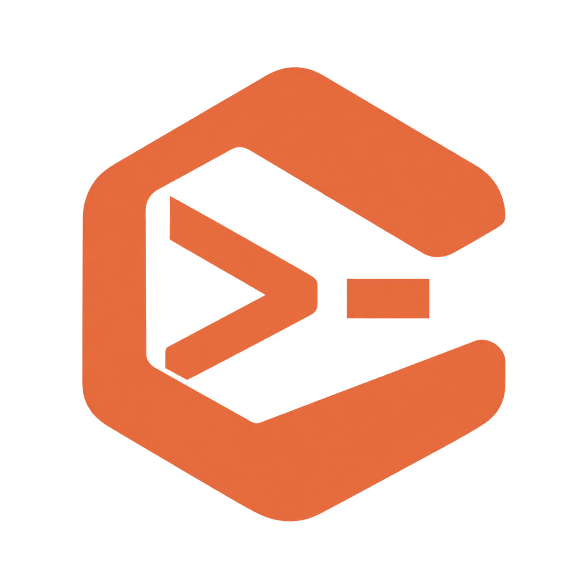

<p align="center">
  
</p>

<h1 align="center">ECA — Easy Coding Agent</h1>

**ECA Desktop 1.0.0（Windows x64）**：桌面工程位于 `desktop/`，支持多项目与多会话并发、主对话与侧聊附件、网页预览、PowerShell 交互终端，以及按需打开的修改审查。与 CLI 共用 Python 核心和项目数据。[下载桌面版](#下载桌面版) · [安装、开发与验收说明](docs/desktop/README.md)。npm 启动器同时提供 `eca` 和兼容命令 `ecs`。

新 Agent 接手请先读 [完整接力文档](HANDOFF.md)：包含本机路径、未提交代码状态、依赖、G 盘缓存、打包更新、测试与陶土界面约定。

主 Agent 默认不限响应轮数和输出截断恢复次数，可用 Ctrl+C 中断。旧配置中的显式上限仍有效，可运行 `ecs --max-turns 0 --output-recovery-limit 0` 取消这两项限制。模型单次输出上限、子 Agent 限额和共享预算的区别见 [输出与持续执行配置](docs/OUTPUT_LIMITS.md)。

<p align="center"><strong>你的项目，你的模型。</strong></p>
<p align="center">通过终端或桌面理解代码、执行修改，并检查每一步留下的结果。</p>

<p align="center">
  <a href="#快速开始">快速开始</a> ·
  <a href="docs/CLI_GUIDE.md">使用手册</a> ·
  <a href="CHANGELOG.md">更新记录</a> ·
  <a href="docs/UPGRADE-v0.18.md">验证记录</a>
</p>

<p align="center"><code>CLI + Windows Desktop</code> · <code>v1.0.0</code> · <code>首个公开版本</code></p>

---

ECA（Easy Coding Agent）是一个可自行配置模型的编程助手，提供 CLI 和 Windows 桌面入口，共用 Python 核心。它可以读取与搜索项目、编辑文件、运行命令，并把完整会话和文件修改记录保存在项目本地。桌面安装包自带运行时；CLI 运行需要 Python 3.11+。

它重视三件事：**改动可检查、工作可继续、记忆有来源。** 你可以先看差异再允许写入，中断后恢复会话，也可以检查或撤销文件工具产生的修改。

> 当前适合个人试用、开发与研究。基础机制已有自动化测试，但真实复杂任务的稳定性仍在验证中；尚未达到成熟编码 CLI 的功能覆盖与可靠性。

大仓库定位：`/related SYMBOL` 查看定义与 Python 调用/导入候选；模型的 `code_search`、`repo_map`、`code_relations` 支持目录筛选与增量读取统计。[用法与验证边界](docs/REPOSITORY_NAVIGATION.md)。

## 下载桌面版

[最新版本](https://github.com/yushui2022/easy-coding-agents/releases/latest) 提供 Windows x64 安装包（`ECA-Desktop-<版本>-x64-Setup.exe`，约 160 MB，**自带 Python 运行时**，无需另外装环境）：

1. 下载并运行安装包，按向导完成安装（默认装在 `G:\Apps\ECA Desktop`，可在向导里改）
2. 打开应用，在「模型与设置」里添加一个你自己的模型连接——DeepSeek / OpenAI / Anthropic，或任何兼容 OpenAI 协议的端点——并填入 API 密钥
3. 选择项目文件夹，开始对话；之后每次启动会直接回到你上次打开的项目

**安装包未购买代码签名证书**：Windows SmartScreen 会提示「未知发布者」，需要点「更多信息 → 仍要运行」。每个版本都在说明里给出 SHA256，可以先核对再安装，详见 [未签名分发说明](docs/desktop/UNSIGNED-DISTRIBUTION.md)。

桌面版目前只支持 **Windows x64**。macOS / Linux 可用 CLI，见下方[快速开始](#快速开始)。

用着有问题或有建议，欢迎开 [Issue](https://github.com/yushui2022/easy-coding-agents/issues)；请附上版本号、你用的模型，以及复现步骤。

## 可选多模型协作

默认只需一个 API，原有用法不变。需要时额外配置云端或本地 Worker，并通过 `worker_profiles` 显式开启，主 Agent 才能按子任务选择模型。不会自动下载本地模型；具体小模型需要支持工具调用并经过任务验证。[配置示例](docs/UPGRADE-v0.13.md)

还可以显式启用 [Worker → 检查 → 主模型修复链路](docs/UPGRADE-v0.14.md)：`--worker-first` 指定先执行的模型，只有检查失败且配置修复预算时才调用主模型接手。

## 能做什么

| 能力 | 实际行为 |
| --- | --- |
| **终端编码** | 流式输出；读取、搜索、编辑文件；执行需要确认的 Shell 命令。 |
| **本地 Skills（源码新增）** | 项目/用户 SKILL.md，`/skills`、`/skill` 显式调用；技能不绕过授权。[说明](docs/SKILLS_REFACTOR_COLLABORATION.md)。 |
| **LSP 重命名（源码新增）** | 跨文件预览、冲突检查、审批和修改后诊断；逐文件记录撤销。[边界](docs/SKILLS_REFACTOR_COLLABORATION.md)。 |
| **协作验收与额度（源码新增）** | 主子 Agent 共享请求次数上限，子任务可指定验收命令，提供单模型/Worker-first 对照评测入口。[配置](docs/SKILLS_REFACTOR_COLLABORATION.md)。 |
| **后台服务（源码新增）** | `/run` 启动服务，`/jobs` 查看状态，`/logs` 读取日志，`/stop` 停止；有并发、日志和存活时间上限，正常会话关闭时清理。[用法与边界](docs/BACKGROUND_PROCESSES.md)。 |
| **联网查资料（源码新增）** | `web_fetch` 授权读取公共 HTTPS 网页；`web_search` 可选接入 Brave Search。提供来源、正文限制和不可信数据标记。[配置说明](docs/WEB_TOOLS.md)。 |
| **浏览器接入示例** | 通过现有 MCP 桥接配置 Playwright，使用页面结构进行操作；本轮未做真实浏览器验收，图片结果尚不传给模型。[边界与示例](docs/WEB_TOOLS.md#浏览器playwright-mcp-配置示例)。 |
| **检查与撤销** | 编辑前展示差异；记录修改前后内容；撤销时检查冲突，保留用户原有内容和 Git 暂存区。 |
| **可靠编辑** | 已读取文件的版本检查；受约束的行尾空白匹配；`edit_many` 全部预检后一次写入、一次撤销。 |
| **固定任务评测** | 源码仓库提供 14 个固定任务，含 SQLite 多模块维护与旧数据库迁移；可显式测试验证与修复闭环，分别记录首次验证和修复结果。真实 API 运行需显式启动。 |
| **会话恢复** | 持久化任务检查点；继续前核对已读写文件、过期验证与不确定操作。`/checkpoint` 查看证据，恢复检查不执行命令。 |
| **上下文超限恢复** | 对明确的供应商上下文超限拒绝，缩小会话预算、压缩历史后最多恢复一次；普通错误和已输出文本的错误不走此路径。 |
| **长任务上下文** | 按 token 估算与字符双预算压缩，计入工具定义并预留输出空间；保留完整历史与最近的完整工具调用组。`/context` 查看本地估算。 |
| **进度与截断恢复** | 最近 12 项文件/命令观察跨摘要保留；输出截断后提示拆分操作，默认不限恢复次数，可配置上限或手动中断。 |
| **显式验收** | 指定任务后的验证命令；检查失败返回退出码 3，文件快照改变后结果标为过期。 |
| **修复与复验** | 最多 10 项顺序检查；显式开启最多 3 轮修复，修复后复验整组，保存各轮结果。 |
| **可选执行隔离** | 实验性 Docker 后端：禁网、受限资源、只读源码副本、命令写入丢弃；后端缺失拒绝执行。 |
| **源码索引** | 本地增量全文检索、符号与导入摘要；`/search`、`/map` 无需模型调用。 |
| **项目记忆** | 记住显式确认的约束和有执行记录支持的历史测试命令；代码指纹变化后排除过期命令记录。 |
| **项目规则** | 文件编辑前加载路径上各级 `AGENTS.md`，先向模型提供适用规则。 |
| **模型选择** | 支持 Chat Completions、Responses 与 Anthropic Messages；命名配置绑定模型、协议、接口和密钥来源。 |
| **脚本调用** | 单次任务、JSONL 输出，以及无需调用模型的文件改动审阅命令。 |
| **MCP** | 可选 SDK；复用 stdio / HTTP 连接，调用工具、读取资源与提示词；逐次授权。 |
| **子 Agent** | 独立快照、并发队列与失败状态；查看子任务改动，选择文件合并、检查冲突并撤销。 |
| **LSP** | 批准后复用进程；同步文件，查询定义/引用/实现；区分当前、无版本和待返回的诊断。 |
| **用量与费用** | 请求级持久账本，涵盖重试、摘要和子任务；按 API 用量与配置价格计算，缺失值明确标注。 |

## 快速开始

需要 **Python 3.11+** 和支持工具调用的模型 API。

### 1. 安装终端命令

已有本地 npm 安装包时（需要 Node.js 20+ 和 Python 3.11+）：

```sh
npm install -g ./easy-coding-agent-cli-0.34.1.tgz
ecs
```

首次启动自动建立独立 Python 环境并安装依赖，之后直接输入 `ecs` 即可。当前包尚未发布到 npm 官网；使用本地安装包无需 npm 账号。[G 盘安装、运行目录与故障处理](docs/NPM_INSTALL.md)

也可以继续通过 Python 安装，安装后 `eca` 和 `ecs` 都可使用：

#### 从源码安装

```sh
git clone https://github.com/yushui2022/easy-coding-agents.git
cd easy-coding-agents
python -m venv .venv
```

激活虚拟环境：

```powershell
# Windows PowerShell
.\.venv\Scripts\Activate.ps1
```

```sh
# macOS / Linux
source .venv/bin/activate
```

安装 CLI：

```sh
python -m pip install -e .
```

Windows 用户可把仓库与虚拟环境放在 `G:\Projects`，使用 `--cache-dir G:\DevCache\pip` 指定 pip 缓存位置。

### 2. 配置模型

在**准备让 ECA 操作的项目目录**创建 `.env`，或设置同名环境变量。选择一种协议即可。

<details open>
<summary><strong>OpenAI 兼容接口</strong></summary>

```dotenv
ECA_API_FORMAT=openai
ECA_API_KEY=your-api-key
ECA_BASE_URL=https://your-provider.example/v1
ECA_MODEL=your-tool-capable-model-id
```

将示例地址、密钥和模型 ID 换成你的实际配置。接口需要支持 **Chat Completions 流式响应与工具调用**。旧的 `MODELSCOPE_API_KEY`、`MODEL_NAME` 配置仍可使用。

</details>

<details>
<summary><strong>Anthropic 原生接口</strong></summary>

```dotenv
ECA_API_FORMAT=anthropic
ANTHROPIC_API_KEY=your-api-key
ANTHROPIC_BASE_URL=https://api.anthropic.com/v1
ECA_MODEL=your-claude-model-id
```

模型 ID 使用你的账号实际可用值。这是 API 接入，不是 Claude 订阅登录。

</details>

不要把 `.env` 提交到 Git。更多选项见 [配置示例](eca.example.toml) 和 [使用手册](docs/CLI_GUIDE.md)。如果已有 `eca.toml`，也要检查其中的 `api_key_env`、模型和地址是否与所选协议一致。

### 3. 启动

进入目标项目目录后运行：

```sh
eca --doctor
eca
```

`--doctor` 离线检查配置、密钥是否设置、状态目录、Shell 和 Git；不调用模型，也不创建会话。存在阻止启动的问题时退出码为 1，其他情况为 0；Git 等非必需能力的问题作为警告显示。也可以用 `eca --cwd ./your-project` 指定一个已存在的项目目录。

首次配置可运行 `ecs --configure`，按提示选择协议、API 地址、模型和密钥环境变量；已有 `eca.toml` 不会被覆盖。若选择保存隐藏输入的密钥，会新建明文 `.env` 并加入 Git 忽略；也可以只使用环境变量，不落盘密钥。已有 `.env` 保留。

需要真实连接检查时运行 `ecs --doctor --check-api`：发送一次最多 16 个输出 token 的探针，不发送源码、不执行工具、不自动重试，可能产生 API 费用。返回成功只验证基本请求，不证明流式输出、工具调用或编码质量。[配置和安装说明](docs/NPM_INSTALL.md)。

## 一个日常工作流

下面是操作示例，不是实测结果截图。模型响应和工具行为取决于具体项目与配置。

```text
code › /mode plan
plan › 看一下项目入口，给出修复这个问题的计划。

plan › /mode code
code › 按计划修改，并运行相关测试。

code › /changes
code › /changes 12
code › /accept 12
```

`12` 是示例 ID，请使用 `/changes` 实际列出的编号。如果要撤销该次文件编辑，用 `/undo 12`；如果文件后来又被修改，ECA 会拒绝覆盖。**`/accept` 是审阅标记，不是 Git 提交。**

| 想做什么 | 命令 |
| --- | --- |
| 查看帮助、模式或停止原因 | `/help` · `/status` |
| 新建、查找和恢复会话 | `/new` · `/sessions` · `/resume ID` |
| 继续未完成工作 | `/continue` |
| 检查或撤销文件编辑 | `/changes` · `/changes ID` · `/undo ID` |
| 查看和维护项目记忆 | `/memory` · `/remember 项目约束` · `/forget ID` |
| 手动摘要、导出会话 | `/compact` · `/export` |
| 退出 | `/exit` |

**Ctrl+C** 中断当前任务并保留会话；**Shift+Tab** 切换模式；**Ctrl+J** 换行。Plan 模式只提供读取、搜索、规划与提问工具；Chat 模式不提供工具。

### 在脚本中使用

```sh
eca --mode plan -p "分析项目入口" --json
eca --accept-edits -p "修正 README 中的一个拼写错误"
eca --resume latest -p "继续之前的任务，先检查中断状态"
eca --changes --json
```

单次任务默认拒绝需要交互确认的操作。`--accept-edits` 允许文件创建、编辑和删除；`--allow-shell` 会授权该任务中的所有 Shell 命令，应只在明确需要时使用。退出码、事件格式与完整命令说明见 [使用手册](docs/CLI_GUIDE.md)。

## 数据、权限与当前边界

- **本地存储，模型远程推理。** 会话、修改快照和项目记忆存放在目标项目的 `.eca/` 中；发送给模型的上下文会交给你配置的 API。请将 `.eca/` 加入目标项目的 `.gitignore`。
- **默认 Shell 仍在宿主机执行。** 可显式选择实验性 `--sandbox docker`；本地 Linux 引擎和预装可信镜像必需，后端失败不降级。容器内写入丢弃，MCP/LSP 禁用。详见 [v0.11](docs/UPGRADE-v0.13.md)。
- **历史成功不代表现在正确。** 记忆中的测试命令只证明当时返回了成功退出码；指纹不覆盖依赖安装状态、环境变量或外部服务。
- **本地恢复不依赖模型配置。** 即使 `.env` 或 `eca.toml` 损坏，仍可使用 `--list-sessions`、`--changes`、`--undo ID` 和 `--accept-change ID`。
- **恢复和摘要也有边界。** 摘要可能遗漏信息；结果不确定的操作不会自动重放。一个项目同时只允许一个 ECA 进程。
- **扩展的边界。** MCP 外部副作用不在撤销范围内；并行子任务使用源码快照并禁止外部进程，旧式 delegate 仍共享目录；费用是按配置价格计算的统计，不替代服务商账单。接入配置见 [扩展功能手册](docs/EXTENSIONS-v0.6.md)。
- **仍未实现** 原生跨平台 OS 沙箱、Git worktree 分支合并、订阅/MCP OAuth、LSP 重命名及完整跨语言语义依赖索引。实验性 Docker 后端已在 Windows/WSL2 通过文件、网络和取消/超时清理实测，其他平台仍待验收；[环境与边界](docs/DOCKER_ACCEPTANCE.md)。本地全文索引不等同于语言服务器。

## 开发与验证

```sh
python -m pip install -r requirements-dev.txt
python -m pip install -e ".[mcp]" # 包含 MCP 本地集成测试所需依赖
python -B -m pytest -q
```

新增可撤销的单文件删除、子 Agent 删除结果合并与冲突检查，详见 [v0.8.1 更新](docs/UPGRADE-v0.8.1.md)。

固定任务基线：`python -B benchmark/agent_eval.py --model deepseek-flash`（需要环境变量中的 API 凭据）。记录完成率、耗时、请求、费用完整性和人工介入；不自动执行，不把模型自述当作验收。详见 [评测手册](benchmark/AGENT_EVAL.md) 和 [v0.18 验证记录](docs/UPGRADE-v0.18.md)。

测试覆盖并发与取消、隔离合并、MCP 连接生命周期、模型配置恢复、Responses SDK 与 LSP 版本化诊断。测试未调用付费模型；真实模型和大型语言服务器表现仍需后续验证。详见 [验证范围与结果](docs/VALIDATION-v0.8.1.md)。

CI 配置目前保留为 [工作流模板](docs/ci-workflow.yml)，尚未启用。跨平台执行和真实仓库长任务稳定性仍需持续验证。

另提供显式运行的 [DeepSeek 在线验收](benchmark/LIVE_ACCEPTANCE.md)：覆盖 Bug 修复、跨文件重构、补测试、并行合并与中断恢复，采用外部断言验收，不纳入默认离线测试。测试仓库为小型固定场景，不代表大型业务项目表现。

[2026-10-17 实测记录](docs/LIVE-ACCEPTANCE-2026-10-17.md)：最终五项全部通过，包含真实请求用量、费用小计及未知项。

进一步完成了 [StockFlow 多模块后端验收](docs/STOCKFLOW-ACCEPTANCE-2026-10-17.md)：36 项外部测试、80 项项目自身测试通过；过程暴露并修复了规则读取后的重复阻断，也记录了人工续跑和上下文调整。后续新增进度保留、输出截断恢复与显式验收，见 [v0.9 升级说明](docs/UPGRADE-v0.9.md)。

```text
eca/                  CLI、执行循环、工具、恢复与记忆适配
agent_memory_core/    可独立研究的记忆存储与检索核心
tests/                自动化回归测试
benchmark/            记忆研究评测，不等同于编码任务评测
docs/                 使用说明、验证记录与历史文档
```

欢迎通过 [Issue](https://github.com/yushui2022/easy-coding-agents/issues) 提供可复现的问题，或提交范围明确的改进。报告时附上版本、操作系统、模型协议、复现步骤和脱敏日志。贡献代码前请阅读 [开发说明](AI_CODER_GUIDE.md)。

## 关于这个项目

这个项目始于一次个人探索，也曾帮助作者找到工作。重新维护它，是想把这段积累继续做成一个自己愿意使用、别人也能理解和改进的工具。

旧入口和研究成果仍然保留：新版 CLI 复用记忆核心的存储与检索，但不自动导入旧研究数据库，也不把未经验证的模型结论变成项目事实。

[更新记录](CHANGELOG.md) · [使用手册](docs/CLI_GUIDE.md) · [记忆核心](agent_memory_core/README.md) · [旧版迁移说明](docs/UPGRADE-v0.2.md)

### SQLite 维护任务实测

DeepSeek 在明确契约后的三个任务中各运行三次，总验收 **9/9**，共 69 次请求、无人工修补。此前含歧义契约的批次为 1/9，完整保留失败记录；本次改进是任务契约澄清，不是运行时能力对照。未触发额外工作流修复，尚不能证明复杂修复可靠性。[完整实测与边界](docs/BASELINE-SQLITE-2026-10-18.md)

开发中的验证升级：相同源码上的相同失败再次出现时停止无效修复；各轮记录之前通过而后失败的检查，CLI 展示停止原因。判断基于保留的诊断文本与有界源码指纹，不代表语义级错误分析。
